# Práctica TAS4 – Red de contenedores MySQL y phpMyAdmin

## 1. Título

**Creación y conexión de contenedores MySQL y phpMyAdmin mediante una red personalizada en Docker.**

## 2. Tiempo de duración

La práctica tuvo una duración aproximada de 120 minutos. 

## 3. Fundamentos

Docker es una herramienta que permite ejecutar aplicaciones dentro de contenedores. En esta práctica entendí que un contenedor es un entorno separado donde se ejecuta un servicio con lo necesario para funcionar. Esto resulta útil porque no hace falta instalar cada aplicación directamente en Windows y se pueden tener varios servicios en una misma computadora. Por ejemplo, puedo tener un contenedor que se encargue de una base de datos y otro que me permita administrarla desde el navegador.

Para crear estos contenedores se utilizan imágenes. Una imagen contiene los archivos y la configuración inicial necesarios para ejecutar una aplicación. Cuando escribimos `docker run`, Docker utiliza esa imagen para crear e iniciar el contenedor. En los comandos también se pueden indicar variables de entorno mediante `-e`. Estas variables sirven para configurar datos importantes, como la contraseña del usuario principal de MySQL o el nombre del servidor al que debe conectarse phpMyAdmin.

MySQL es un sistema gestor de bases de datos relacionales. Su función es almacenar y organizar información en bases de datos. Por otro lado, phpMyAdmin es una herramienta que se utiliza desde el navegador para administrar servidores MySQL. Con ella podemos crear bases de datos, consultar información y realizar distintas operaciones sin escribir todos los comandos directamente en una terminal. En esta actividad usé phpMyAdmin para crear una base de datos de prueba.

Otro tema importante son los puertos. Un puerto permite identificar un servicio dentro de una computadora o un contenedor. Docker puede relacionar un puerto de Windows con otro del contenedor mediante la opción `-p`. Por ejemplo, en MySQL utilicé `3307:3306`, donde 3307 corresponde a Windows y 3306 al servicio dentro del contenedor. En phpMyAdmin utilicé `8091:80`, lo que permitió abrir su interfaz desde `localhost:8091`.

También aprendí para qué sirven las redes de Docker. Aunque los contenedores se ejecuten en la misma computadora, necesitan una forma de comunicarse entre ellos. Para esta práctica creé una red personalizada llamada `redmysql`, de tipo *bridge*, y conecté ambos contenedores a ella. Al revisar la red observé que Docker les asignó direcciones IP internas diferentes. Sin embargo, para establecer la conexión es más práctico utilizar el nombre `mysql-server`, porque la dirección IP puede cambiar si se vuelve a crear un contenedor.

Finalmente, con `docker network inspect` pude revisar qué contenedores estaban conectados a la red. Esta comprobación me ayudó a entender que no basta con crear los contenedores: también es necesario configurar correctamente su comunicación para que phpMyAdmin pueda acceder al servidor MySQL.

**Figura 3-1.** Diagrama de comunicación entre los contenedores en la red `redmysql`.

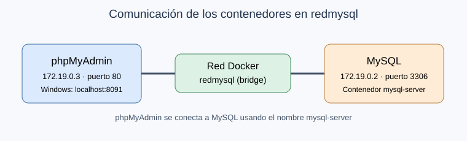

## 4. Conocimientos previos

Para realizar esta práctica necesité conocer lo básico de Docker Desktop, cómo abrir Git Bash y cómo ejecutar comandos en una terminal. También fue útil saber qué es un contenedor, para qué sirve una base de datos, qué significa un puerto y cómo ingresar a una aplicación desde el navegador utilizando `localhost`.

## 5. Objetivos a alcanzar

- Crear un contenedor MySQL con las credenciales necesarias para acceder al servidor.
- Crear un contenedor phpMyAdmin y configurar el servidor MySQL al que debe conectarse.
- Crear una red personalizada en Docker y conectar ambos contenedores.
- Comprobar la comunicación entre los contenedores y crear una base de datos de prueba desde phpMyAdmin.

## 6. Equipo necesario

- Computadora con Windows.
- Docker Desktop instalado y en funcionamiento.
- Git Bash para ejecutar los comandos.
- Conexión a Internet para descargar las imágenes de Docker.
- Navegador web para acceder a phpMyAdmin.
- Imágenes Docker `mysql:8.0` y `phpmyadmin:latest`.

## 7. Material de apoyo

- Guía de la asignatura: *Puertos y red en contenedores*.
- Enunciado de la actividad TAS4 – Red de contenedores MySQL y phpMyAdmin.
- Documentación oficial de Docker sobre contenedores y redes.
- Documentación de MySQL y phpMyAdmin.

## 8. Procedimiento

### Paso 1. Revisar los contenedores existentes

Primero abrí Docker Desktop y luego Git Bash. Para comprobar que Docker estuviera funcionando ejecuté `docker ps`. En la lista aparecieron algunos contenedores que ya tenía de prácticas anteriores, así que los dejé como estaban.

```bash
docker ps
```

**Figura 8-1.** Comprobación inicial de los contenedores en Docker.

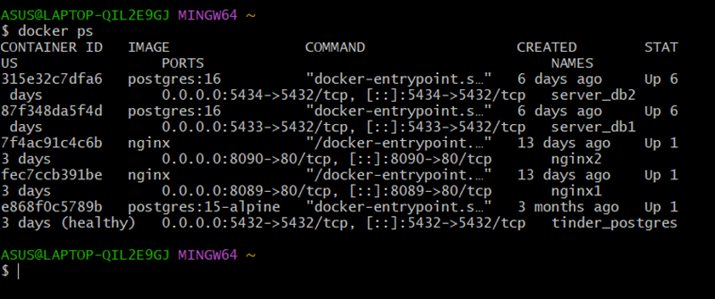

### Paso 2. Crear el contenedor MySQL

Después ejecuté el comando para crear el contenedor `mysql-server`. Configuré la contraseña del usuario `root` para esta práctica y utilicé el puerto 3307 de Windows conectado al 3306 de MySQL. Docker descargó la imagen porque todavía no estaba disponible en mi computadora.

```bash
docker run -d --name mysql-server -e MYSQL_ROOT_PASSWORD=admin123 -p 3307:3306 mysql:8.0
```

**Figura 8-2.** Descarga de la imagen y creación del contenedor MySQL.

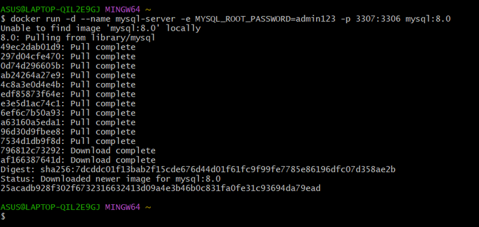

Luego volví a ejecutar `docker ps` para comprobar que el contenedor apareciera en ejecución.

```bash
docker ps
```

**Figura 8-3.** Verificación del contenedor `mysql-server` en ejecución.

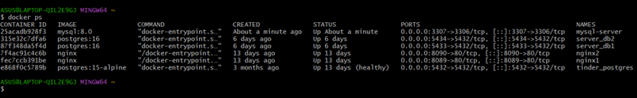

### Paso 3. Crear la red personalizada

Una vez creado MySQL, hice una red llamada `redmysql` con la opción `--attachable`, siguiendo la guía del profesor.

```bash
docker network create --attachable redmysql
```

**Figura 8-4.** Creación de la red personalizada `redmysql`.

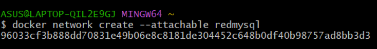

### Paso 4. Conectar MySQL a la red

Con la red creada, conecté el contenedor MySQL mediante el siguiente comando. Como no apareció ningún error, continué con el otro contenedor.

```bash
docker network connect redmysql mysql-server
```

**Figura 8-5.** Conexión del contenedor MySQL a la red.

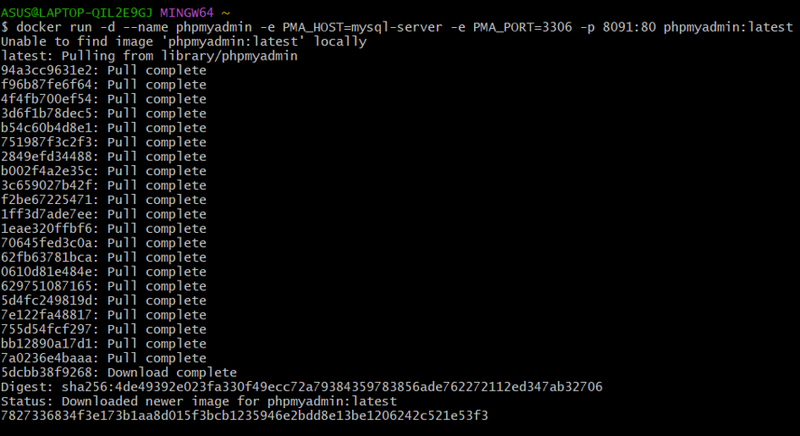

### Paso 5. Crear el contenedor phpMyAdmin

Después creé el contenedor `phpmyadmin`. En este comando indiqué `PMA_HOST=mysql-server` para que phpMyAdmin utilizara el nombre del servidor MySQL y configuré el acceso desde Windows mediante el puerto 8091. Docker descargó la imagen correspondiente.

```bash
docker run -d --name phpmyadmin -e PMA_HOST=mysql-server -e PMA_PORT=3306 -p 8091:80 phpmyadmin:latest
```

**Figura 8-6.** Descarga de la imagen y creación del contenedor phpMyAdmin.

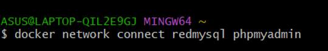

### Paso 6. Conectar phpMyAdmin a la red

Con phpMyAdmin creado, lo conecté a la misma red que MySQL.

```bash
docker network connect redmysql phpmyadmin
```

**Figura 8-7.** Conexión de phpMyAdmin a `redmysql`.

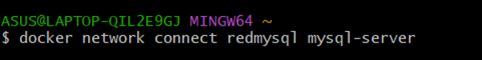

### Paso 7. Verificar la red y las direcciones IP

Para comprobar que los dos contenedores estuvieran conectados, ejecuté `docker network inspect redmysql`. En el resultado aparecieron `mysql-server` con la dirección `172.19.0.2` y `phpmyadmin` con la dirección `172.19.0.3`. De esta manera pude confirmar que ambos pertenecían a la misma red personalizada.

```bash
docker network inspect redmysql
```

**Figura 8-8.** Inspección de la red y direcciones IP de los dos contenedores.

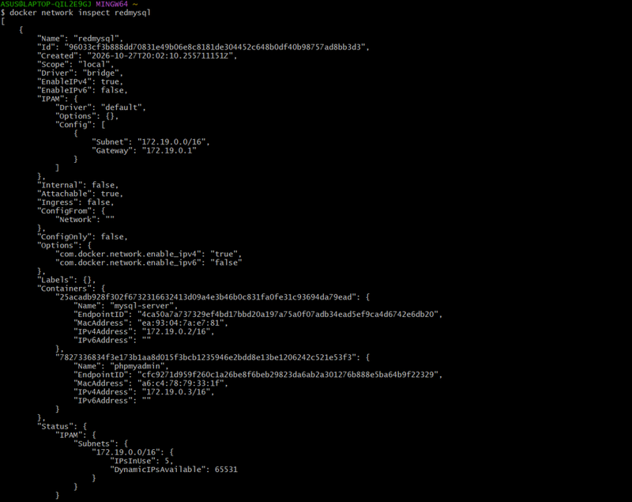

### Paso 8. Acceder a phpMyAdmin

Luego abrí el navegador y entré a `http://localhost:8091`. Apareció el inicio de sesión de phpMyAdmin, donde utilicé el usuario `root` y la contraseña que había configurado para MySQL. Después pude entrar al panel de administración.

**Figura 8-9.** Pantalla de inicio de sesión de phpMyAdmin.

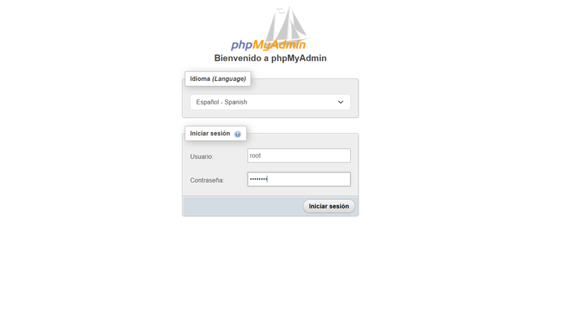

### Paso 9. Crear una base de datos de prueba

Dentro de phpMyAdmin seleccioné la opción para crear una nueva base de datos. Escribí el nombre `bd_prueba_tas4` y presioné el botón **Crear**.

**Figura 8-10.** Nombre de la base de datos de prueba antes de crearla.

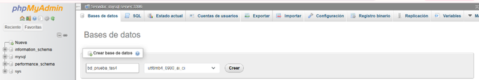

Finalmente comprobé que `bd_prueba_tas4` apareciera en el menú izquierdo. Con eso terminé lo solicitado en la parte práctica, ya que no se pedía crear tablas ni ingresar registros.

**Figura 8-11.** Base de datos `bd_prueba_tas4` creada correctamente.

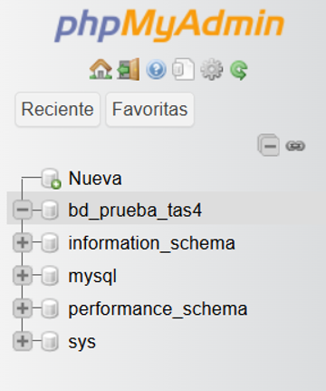

## 9. Resultados esperados

Al terminar la práctica logré crear los dos contenedores solicitados, uno para MySQL y otro para phpMyAdmin. También pude crear la red `redmysql` y comprobar, mediante el comando `docker network inspect`, que los dos contenedores estaban conectados y tenían direcciones IP internas diferentes.

Lo más importante fue que conseguí entrar a phpMyAdmin desde el navegador y conectarme al servidor `mysql-server:3306`. Desde esa interfaz creé la base de datos `bd_prueba_tas4` y comprobé que aparecía en el menú izquierdo.

Esta actividad me ayudó a entender mejor cómo se comunican los contenedores de Docker y para qué sirven los puertos y las redes personalizadas. Al principio estaba más acostumbrada a crear contenedores por separado, pero en esta práctica pude ver cómo se relacionan dos servicios para trabajar juntos.

La evidencia del resultado final se muestra en la **Figura 8-11**, donde aparece la base de datos creada.

## 10. Bibliografía

- Docker Inc. (s. f.). *Docker networking overview*. Docker Docs. https://docs.docker.com/engine/network/
- Docker Inc. (s. f.). *Docker CLI reference*. Docker Docs. https://docs.docker.com/reference/cli/docker/
- Oracle. (s. f.). *MySQL 8.0 Reference Manual*. https://dev.mysql.com/doc/refman/8.0/en/
- phpMyAdmin contributors. (s. f.). *phpMyAdmin documentation*. https://docs.phpmyadmin.net/
- Material de la asignatura. (2026). *Puertos y red en contenedores* [Guía de clase].
